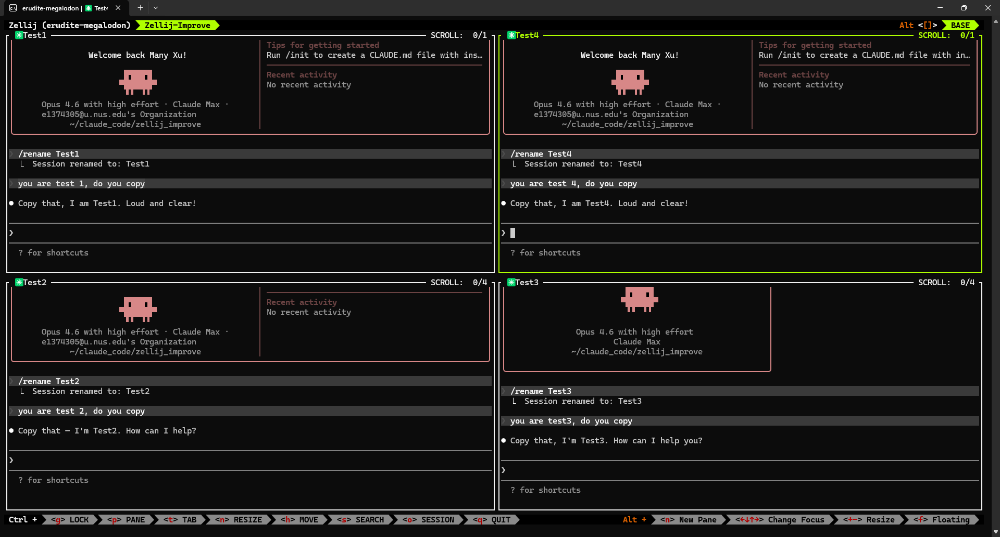
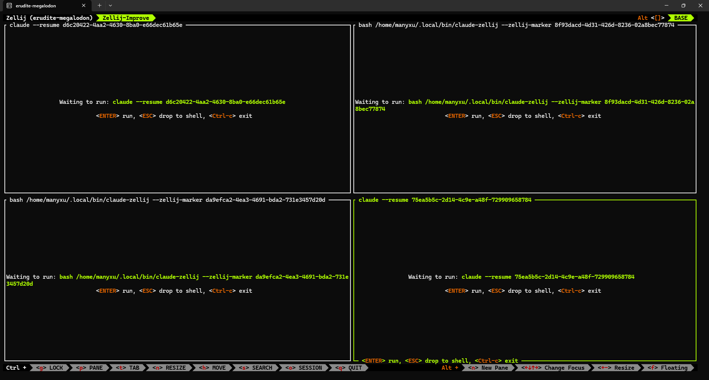
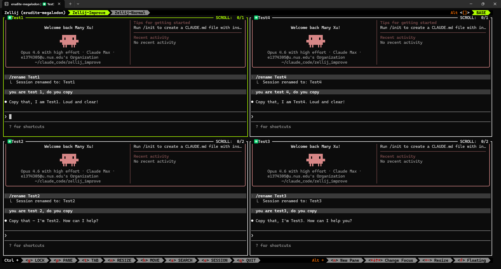

# zellij-claude-enhance

Automatic session recovery for [Claude Code](https://docs.anthropic.com/en/docs/claude-code) and [Codex CLI](https://github.com/openai/codex) running inside [Zellij](https://zellij.dev/), plus one-key reconnect for SSH panes.

## The Problem

If you run multiple Claude Code or Codex instances across Zellij tabs and panes, an unexpected WSL shutdown, terminal crash, or `pkill -9 zellij` wipes out every conversation. Zellij can resurrect panes and re-run the last command in each, but by default it just runs `claude` or `codex` again — starting a fresh session instead of resuming the one you were working in.

With 8+ AI panes open, reconnecting each one manually is painful.

SSH panes have a related problem. When the network path drops, for example when a laptop sleeps or a VPN reconnects, ssh does not notice. The pane stops responding until you kill ssh with `Enter ~ .` and reconnect by hand, pane by pane.

## The Solution

Thin wrapper scripts — `claude-zellij`, `codex-zellij` and `ssh-zellij` — plus a Zellij resurrection hook that together give you **per-pane session recovery**, **in-place hot reboot** and **one-key SSH reconnect**:

| Tool | Wrapper | Recovery |
|---|---|---|
| Claude Code | `claude-zellij` | Per-pane UUID tracking + `/resume` change detection |
| Codex CLI | `codex-zellij` | Per-pane session capture + inline mode (`--no-alt-screen`) |
| Bare `claude` | (none needed) | Best-effort fallback via `claude --continue` |
| Bare `codex` | (none needed) | Best-effort fallback via `codex resume --last` |
| SSH | `ssh-zellij` | Ctrl+Y reconnect + automatic reconnect; bare `ssh` panes are resurrected through it |

If a stored session ID no longer resolves — Claude Code deletes sessions after ~30 days, and a session that never received a message is never written to disk — recovery degrades gracefully (`claude --continue` for bare claude, a fresh tracked session for `claude-zellij`) instead of dying with `No conversation found with session ID`.

After a crash, just reattach (`zellij attach <session>`) and every AI pane picks up exactly where it left off.

`claude-zellij` also supports **Ctrl+Y hot reboot** — restart Claude in-place without losing your conversation. This is useful when you change Claude's settings, CLAUDE.md instructions, or MCP server configuration and need Claude to pick them up without starting a new session.

`ssh-zellij` uses the same key for SSH panes: **Ctrl+Y** drops a dead or hung connection and reconnects in the same pane, and lost connections are detected and reconnected automatically. See [SSH](#ssh).

## Demo

### 1. Before crash — 4 Claude instances running



Four `claude-zellij` panes (Test1–Test4) each hold an independent conversation in the same Zellij session.

### 2. After crash — Zellij resurrection pending



After `pkill -9 zellij` and `zellij attach`, Zellij reconstructs each pane with the correct recovery command. Panes launched via `claude-zellij` show `claude --resume <session-id>` or re-exec the wrapper with the marker UUID. Press **Enter** to resume.

### 3. After recovery — conversations restored



All four conversations are back exactly where they left off — each pane resumes its own session, not somebody else's.

## How It Works

Both AI wrappers follow the same architecture:

```
1. Generate a marker UUID
2. Re-exec the wrapper with --zellij-marker <uuid> baked into the command line
3. Start the AI CLI as a child process (NOT exec)
4. A background watcher captures/tracks the real session ID
5. Zellij serializes "wrapper --zellij-marker <uuid> ..." to disk
6. On resurrection, the wrapper reads the stored session ID and resumes
```

### Why not just `exec`?

The original approach used `exec claude --session-id <uuid>`, which replaces the wrapper process with Claude. This caused two issues:

- **MCP server interference**: Claude spawns MCP servers (e.g., Context7) as child processes. Zellij's command discovery could pick up an MCP process instead of Claude, corrupting the resurrected command.
- **`/resume` blindness**: If you use `/resume` inside Claude to switch conversations mid-session, the original `--session-id` becomes stale. On crash recovery, you'd land on the wrong conversation.

By running the CLI as a child process and keeping the wrapper alive, Zellij serializes the wrapper command (with its marker UUID), and the wrapper tracks session changes in real time.

### Claude: `/resume` and `/clear` tracking

Each claude process maintains a registry entry at `~/.claude/sessions/<pid>.json` and rewrites its `sessionId` field in place whenever the active session changes — via the `/resume` picker, `/resume <name-or-uuid>`, or `/clear`. The `claude-zellij` background watcher polls the registry entry of its own claude child (found through the PTY proxy's process tree), so tracking is pane-exact and immediate: switching sessions and quitting Zellij right away still records the correct session, with no need to type a message first. On resurrection, `claude --resume` uses the tracked ID.

On claude versions without the sessions registry, the watcher falls back to a `~/.claude/history.jsonl` heuristic, which only detects a switch once the next prompt is typed in the new session.

### Codex: session ID capture

Codex doesn't support `--session-id`, so `codex-zellij` captures the session ID from `~/.codex/session_index.jsonl` after Codex starts. The wrapper enables `--no-alt-screen` for interactive sessions and keeps Codex's normal rich rendering. Zellij must be at least 0.44.1 to retain this history; the tested release is 0.45.1.

### Claude: Ctrl+Y hot reboot

Sometimes you need to restart Claude without losing your conversation — for example, after editing `CLAUDE.md`, changing MCP server configuration, or updating Claude Code settings. Normally this means quitting Claude and manually running `claude --resume`, losing your pane context.

`claude-zellij` solves this with a **PTY proxy** (`claude-zellij-pty.py`) that sits between Zellij and the Claude process:

```
Zellij pane ↔ claude-zellij-pty.py (PTY proxy) ↔ Claude child process
```

When you press **Ctrl+Y**:

1. The proxy sends SIGTERM to the running Claude child process
2. It reads the current session ID from the marker file (which the `/resume` watcher keeps up to date)
3. It launches a new `claude --resume <session-id>` on a fresh PTY
4. Terminal dimensions are synchronized so Claude's TUI renders correctly
5. The new Claude instance picks up right where you left off, with all settings reloaded

This happens in-place — no new pane, no tab switching, no manual `--resume` flag. The Zellij pane stays the same, and from the user's perspective Claude simply restarts in the same conversation with refreshed configuration.

Because the wrapper `exec`s into the PTY proxy, the proxy is the process Zellij discovers and serializes. The resurrection hook recognizes the serialized proxy command line (`... claude-zellij-pty.py --wrapper <path> --marker <uuid> -- claude ...`) and rewrites it back to `claude-zellij --zellij-marker <uuid>`, so recovery always goes through the wrapper's marker logic instead of replaying a stale `claude --session-id` command.

### SSH: Ctrl+Y reconnect proxy

A plain `ssh` pane freezes when its network path dies: a laptop sleeps, Wi-Fi or a VPN changes, or a mesh VPN such as Tailscale briefly drops the local address. Without `ServerAliveInterval`, ssh cannot tell the link is gone. It waits for the kernel instead, which gives up only after about 15 minutes of retransmitting your keystrokes, or after 2 hours of TCP keepalive when idle. Meanwhile the terminal is in raw mode, so every key, Ctrl+C included, goes into the dead connection. Zellij itself is fine, but it has no action that restarts a pane's process, so the fix has to run inside the pane.

`ssh-zellij` puts a PTY proxy in front of ssh, the same idea as the Claude hot reboot:

```
Zellij pane ↔ ssh-zellij (PTY proxy) ↔ ssh child process
```

1. Before starting ssh, it reads the effective configuration with `ssh -G`. It adds `ServerAliveInterval=10` and `ConnectTimeout=10` only when your configuration leaves them unset, so a dead link ends ssh in about 40 seconds.
2. ssh runs on a private PTY that gets the pane's terminal modes and size, so the remote side sees the same terminal as with plain ssh. Pane resizes are forwarded.
3. **Ctrl+Y** terminates ssh's process group, escalating to SIGKILL after half a second, resets the terminal, and starts ssh again.
4. When ssh exits by itself, the proxy reads its exit status and last lines of output. A normal logout ends the proxy too. Exit status 255 after an authentication, host key or configuration error, or after the `~.` escape, waits for a key. Any other exit status 255 is a lost connection and reconnects with backoff.

## Prerequisites

- [Zellij](https://zellij.dev/) 0.43+
- [Claude Code CLI](https://docs.anthropic.com/en/docs/claude-code) (`claude`) and/or [Codex CLI](https://github.com/openai/codex) (`codex`)
- Python 3 (for the Ctrl+Y PTY proxies)
- OpenSSH client (`ssh`), only for `ssh-zellij`
- `uuidgen` (pre-installed on most Linux distributions)
- Bash 4+

## Quick Start

```bash
git clone https://github.com/Shengfeng233/zellij-claude-enhance.git
cd zellij-claude-enhance
./install.sh

# Now use these instead of bare claude/codex/ssh:
claude-zellij
codex-zellij
ssh-zellij user@server.example.com
```

If Zellij crashes or WSL shuts down, just reattach:

```bash
zellij attach <session-name>
# Every AI pane resumes automatically
```

## Installation

### Basic (recovery only)

```bash
./install.sh
```

### With optional status-bar layout fix

```bash
./install.sh --with-layout
./install.sh --with-layout --stock-status-bar   # same layout, Zellij's own status bar
```

The layout's status bar also lists **Move Tab** (`Alt+i` / `Alt+o`), which Zellij's own bar never shows. See [Move Tab hint](#move-tab-hint).

### What the installer does

1. Copies `claude-zellij`, `claude-zellij-pty.py`, `codex-zellij`, `ssh-zellij`, `zellij-resurrect-hook.sh`, and `zellij-fix-statusbar.sh` to `~/.local/bin/`
   - `codex-zellij` is only installed if `codex` is found on PATH
   - `ssh-zellij` is only installed if `ssh` is found on PATH
2. Normalizes serialized layouts of dead sessions (`zellij-fix-statusbar.sh`) so their status bars survive resurrection
3. Backs up `~/.config/zellij/config.kdl`
4. Patches these Zellij config settings:

| Setting | Value | Purpose |
|---|---|---|
| `on_force_close` | `"detach"` | Detach instead of quit on crash |
| `session_serialization` | `true` | Serialize pane commands to disk |
| `post_command_discovery_hook` | path to hook script | Transform commands on resurrection |
| `mouse_mode` | `true` | Let the wheel scroll individual panes |
| `pane_frames` | `true` | Show pane frames |
| `pane_frame_style` | `"full"` | Keep full pane boundaries, spacing, and scroll-position display |

5. Removes the obsolete managed scroll-shortcut block from earlier installations. The scrolling fix is in the upgraded Zellij terminal parser.
6. With `--with-layout`: installs `statusbar-fixed.kdl` and sets `default_layout "statusbar-fixed"` so every new session keeps the status bar pinned. When new sessions run Zellij 0.45.x it also installs the status bar with the Move Tab hint to `~/.local/share/zellij-improve/plugins/status-bar.wasm`, points the layout at it and grants it its permissions; `--stock-status-bar` or any other Zellij version keeps the built-in bar
7. Installs `zellij-color-env.sh` and sources it from the wrappers and existing Bash/Zsh rc files (backed up first). It repairs automation-inherited color settings only in interactive Zellij panes.

The installer **will not** silently overwrite an existing `post_command_discovery_hook`. If a conflict is detected, it aborts with a clear error.

### PATH

If `~/.local/bin` is not on your PATH, add to your shell profile:

```bash
export PATH="$HOME/.local/bin:$PATH"
```

## Usage

### Claude Code

```bash
# Per-pane recovery — UUID injected automatically:
claude-zellij
claude-zellij --dangerously-skip-permissions
claude-zellij --model sonnet "review this code"

# Pass-through (no UUID, no recovery):
claude-zellij -p "one-shot prompt"
claude-zellij --resume <existing-id>
claude-zellij doctor
claude-zellij mcp
```

Recovery flow:

```
claude-zellij --dangerously-skip-permissions
  → re-exec: claude-zellij --zellij-marker <marker> --dangerously-skip-permissions
  → proxy:   claude-zellij-pty.py intercepts Ctrl+Y and keeps terminal resize in sync
  → child:   claude --session-id <uuid> --dangerously-skip-permissions
  → watcher: polls ~/.claude/sessions/<pid>.json for session switches (/resume, /clear)
  → Zellij serializes the wrapper command
  → crash → reattach → wrapper reads marker → claude --resume <session-id>
```

If you use `/resume` (picker or by name/ID) or `/clear` inside Claude, the watcher detects the session change within about a second and updates the stored ID — even if you quit Zellij immediately afterwards without typing anything. Resurrection lands on the correct conversation.

Hot reboot:

- Focus a `claude-zellij` pane in Zellij normal mode
- Press `Ctrl+Y`
- The wrapper terminates the current Claude child and relaunches `claude --resume <current-session-id>`
- This reloads Claude settings and skills while keeping you in the same conversation
- The helper keeps terminal resize/redraw state in sync with Zellij so Claude's screen stays stable

### Codex CLI

```bash
# Per-pane recovery + inline mode:
codex-zellij
codex-zellij --full-auto
codex-zellij --model o3 "refactor this"

# Interactive subcommands get inline mode with normal rich rendering:
codex-zellij resume --last
codex-zellij fork --last

# Non-interactive commands pass through unchanged:
codex-zellij exec "one-shot prompt"
codex-zellij review
codex-zellij login
```

Recovery flow:

```
codex-zellij --full-auto
  → re-exec: codex-zellij --zellij-marker <uuid> --full-auto
  → child:   codex --no-alt-screen --full-auto
  → watcher: captures session ID from ~/.codex/session_index.jsonl
  → crash → reattach → wrapper reads marker → codex resume <session-id> --no-alt-screen
```

### SSH

Use `ssh-zellij` exactly like `ssh`:

```bash
ssh-zellij user@server.example.com
ssh-zellij -t server.example.com tmux new -A -s main   # remote tmux keeps your shell across reconnects
ssh-zellij -N -L 8888:localhost:8888 server.example.com   # tunnels reconnect too
```

- **Ctrl+Y** drops the current connection, even a hung one, and reconnects in the same pane within about a second.
- **A lost connection reconnects by itself** about 40 seconds after the link goes silent. Retries back off from 1 s to 30 s. During the countdown, `Ctrl+Y` or `Enter` reconnects at once and `q` or `Ctrl+C` returns to the shell.
- **Some exits wait for you instead.** Retrying automatically after an authentication, host key or configuration error could trigger fail2ban. After the `~.` escape, or in a session started with a remote command, a retry would re-run something you may not want. Press `Ctrl+Y` or `Enter` to retry.
- **The terminal is reset before reconnecting.** Modes a dead remote program left on are turned off: alternate screen, mouse reporting, hidden cursor, bracketed paste, and the kitty keyboard protocol. Otherwise the mouse wheel would type escape codes into the new shell.
- **A normal logout exits with ssh's status**, like plain ssh. Without a terminal, for example in scripts or pipes, ssh-zellij simply runs ssh.

| Variable | Default | Meaning |
|---|---|---|
| `SSH_ZELLIJ_KEY` | `^Y` | Reconnect key: any `^A`..`^Z`, `^]`, `^\`, or `none`. Ctrl+Y no longer reaches remote programs, which matters for bash and Emacs yank or nano's page up |
| `SSH_ZELLIJ_AUTO` | interactive only | `1` also reconnects sessions with a remote command, `0` never reconnects without a key press |

A reconnect starts a new remote login. Programs running in the old shell's foreground end when the server notices the old connection is gone. Run long jobs under `tmux`, `nohup`, or a job runner on the remote side.

Zellij serializes a pane running `ssh-zellij` like any other command. The resurrection hook also rewrites bare `ssh ...` panes to `ssh-zellij ...`, so ssh panes typed with plain `ssh` come back with reconnect support after a crash.

### Bare CLI fallback

Commands run without the wrapper still get best-effort recovery:

- `claude` → `claude --continue` (resumes most recent conversation in CWD)
- `codex` → `codex resume --last --no-alt-screen` (resumes most recent session in CWD, preserves `-C/--cd`)

This works for single-pane setups. For multiple AI panes in the same directory, use the wrappers.

### What is NOT recovered

Non-AI commands other than `ssh` pass through the hook unchanged:

```bash
npm exec @upstash/context7-mcp   # unchanged
vim                                # unchanged
claude -p "one-shot"               # non-interactive, nothing to resume
codex exec "one-shot"              # non-interactive, nothing to resume
```

## Status-Bar Pinning

### The bug

In resurrected sessions, the status bar sometimes jumps into the middle of the screen (or into a pane stack) when you open/close panes or cycle swap layouts, leaving an empty one-line pane at the bottom.

Root cause (zellij ≤ 0.43.x): session serialization writes live plugin panes with canonical URLs (`zellij:status-bar`) but swap-layout slots with the unprefixed alias (`status-bar`). After resurrection, swap-layout application matches plugin panes to slots **by location string** — the mismatch makes the bars count as regular panes, and the next swap (manual `Alt+[`/`Alt+]`, or automatic on pane open/close) sweeps the status bar into the tiled grid.

### The fix (two parts)

1. **`statusbar-fixed.kdl`** — mirrors Zellij's built-in default layout and swap layouts, but uses the canonical `zellij:` URLs on both sides, so the strings still match after a serialize/resurrect round-trip. Installed and set as `default_layout` by `./install.sh --with-layout`; new sessions are immune from birth.
2. **`zellij-fix-statusbar.sh`** — normalizes the cached `session-layout.kdl` of every *dead* session that was created before the fix. The installer runs it once, and the resurrection hook re-runs it in the background on every resurrection, so after a multi-session crash the first session you attach heals the rest.

```bash
./install.sh --with-layout
zellij -n statusbar-fixed -s test    # try it without making it the default

# Heal previously serialized sessions manually at any time:
zellij-fix-statusbar.sh
```

Sessions that are currently running cannot be healed in place (the server rewrites their cache); they get healed automatically after they exit or crash.

### Move Tab hint

Zellij binds `Alt+i` / `Alt+o` to move the current tab left / right, but its status bar never mentions it: the hint list is compiled into the built-in plugin. `status-bar/` holds a patched build of that plugin (Zellij 0.45.1 plus `move-tab-hint.patch`) that adds:

| Mode | Hint |
|---|---|
| Normal | `Alt + … <i\|o> Move Tab` after the other `Alt` shortcuts |
| Tab (`Ctrl+t`) | `Alt <i\|o> Move tab` after Move (focus) |
| Move (`Ctrl+h`) | `Alt <i\|o> Move tab` after Switch Location |

The keys come from your keybindings, so a rebound `MoveTab` is shown as bound. In normal mode the hint is the first to go when the line is short: the bar uses short labels (`New`, `Focus`) to keep it, and below about 165 columns with several panes Zellij already replaces the whole `Alt` group with `...`. Tab mode shows it at any width.

Built-in plugins load from inside the Zellij binary, so the layout loads this one as `file:/home/<you>/.local/share/zellij-improve/plugins/status-bar.wasm`. The absolute URL serializes unchanged, so the bar stays pinned across resurrection as with `zellij:`. A `file:` plugin needs permission to read the session state; a prompt in a one-row, unfocused pane could not be answered, so `zellij-fix-statusbar.sh` pre-grants it in `~/.cache/zellij/permissions.kdl` (it runs before every new server via `~/.local/bin/zellij`) and switches dead sessions' saved bars to the installed one, or back to `zellij:status-bar` when it is removed.

Running sessions keep the bar they started with; new sessions, and sessions resurrected later, get the hint. The plugin is tied to the Zellij release series it was built for; after changing `upgrade-zellij.sh`'s version, set `status-bar/ZELLIJ_VERSION` and rebuild:

```bash
./status-bar/build.sh    # clones that Zellij release, applies the patch, builds with its pinned Rust in a temp dir
./install.sh --with-layout
```

## Verification

### Syntax check

```bash
bash -n ~/.local/bin/claude-zellij
python3 -m py_compile ~/.local/bin/claude-zellij-pty.py
bash -n ~/.local/bin/codex-zellij
bash -n ~/.local/bin/zellij-resurrect-hook.sh
python3 -c 'import sys; compile(open(sys.argv[1]).read(), sys.argv[1], "exec")' ~/.local/bin/ssh-zellij
```

### Regression tests

```bash
python3 -m unittest discover -s tests -v
```

The ssh-zellij tests drive the proxy on a pseudo-terminal with a fake `ssh` on PATH, so they need no network or sshd.

### Hook tests

```bash
# Claude
RESURRECT_COMMAND="claude" ~/.local/bin/zellij-resurrect-hook.sh
# → claude --continue

RESURRECT_COMMAND="claude --session-id 11111111-1111-1111-1111-111111111111" \
  ~/.local/bin/zellij-resurrect-hook.sh
# → claude --resume 11111111-1111-1111-1111-111111111111  (if that session exists on disk)
# → claude --continue                                      (if it expired / was never used)

# Serialized PTY proxy (what Zellij discovers for claude-zellij panes)
RESURRECT_COMMAND="python3 $HOME/.local/bin/claude-zellij-pty.py --wrapper $HOME/.local/bin/claude-zellij --marker 22222222-2222-2222-2222-222222222222 -- claude --session-id 11111111-1111-1111-1111-111111111111" \
  ~/.local/bin/zellij-resurrect-hook.sh
# → /home/<you>/.local/bin/claude-zellij --zellij-marker 22222222-2222-2222-2222-222222222222

# Codex
RESURRECT_COMMAND="codex" ~/.local/bin/zellij-resurrect-hook.sh
# → codex resume --last --no-alt-screen

RESURRECT_COMMAND="codex exec do something" ~/.local/bin/zellij-resurrect-hook.sh
# → codex exec do something  (unchanged)

# SSH
RESURRECT_COMMAND="ssh user@server.example.com" ~/.local/bin/zellij-resurrect-hook.sh
# → /home/<you>/.local/bin/ssh-zellij user@server.example.com

# Other
RESURRECT_COMMAND="npm exec @upstash/context7-mcp" ~/.local/bin/zellij-resurrect-hook.sh
# → npm exec @upstash/context7-mcp  (unchanged)
```

### End-to-end crash test

> **Warning**: This kills all running Zellij sessions. Only run when you have no important work open.

```bash
# 1. Start a test session
zellij -s test-recovery

# 2. Run claude-zellij (or codex-zellij), send a message

# 3. From ANOTHER terminal:
pkill -9 zellij

# 4. Reattach:
zellij attach test-recovery

# 5. The pane should show the resume command — press Enter to continue
```

## Files

| File | Installed to | Description |
|---|---|---|
| `claude-zellij` | `~/.local/bin/claude-zellij` | Claude wrapper with marker UUID + `/resume` tracking |
| `claude-zellij-pty.py` | `~/.local/bin/claude-zellij-pty.py` | PTY proxy for Claude hot reboot that keeps terminal resize in sync |
| `codex-zellij` | `~/.local/bin/codex-zellij` | Codex wrapper with marker UUID + session capture + inline mode |
| `ssh-zellij` | `~/.local/bin/ssh-zellij` | ssh PTY proxy with Ctrl+Y reconnect, dead-link detection and automatic reconnect |
| `zellij-resurrect-hook.sh` | `~/.local/bin/zellij-resurrect-hook.sh` | Zellij resurrection hook for Claude/Codex/ssh commands |
| `zellij-fix-statusbar.sh` | `~/.local/bin/zellij-fix-statusbar.sh` | Heals serialized session layouts so status bars survive resurrection |
| `zellij-layout-repair.py` | `~/.local/bin/zellij-layout-repair.py` | Repairs stock new-tab templates and serialized common-root cwd, with backups |
| `statusbar-fixed.kdl` | `~/.config/zellij/layouts/statusbar-fixed.kdl` | Layout with pinned status bar (resurrection-safe plugin URLs) |
| `status-bar/status-bar.wasm` | `~/.local/share/zellij-improve/plugins/status-bar.wasm` | Zellij 0.45.1 status bar plus the Move Tab hint (`--with-layout`) |
| `status-bar/move-tab-hint.patch`, `build.sh`, `ZELLIJ_VERSION` | *(run from repo)* | Source patch and reproducible build of that plugin |
| `upgrade-zellij.sh` | *(run from repo)* | Verified Zellij release installer; retains old servers |
| `zellij-dispatch` | `~/.local/bin/zellij` | Routes CLI commands to the active server version |
| `zellij-color-env.sh` | `~/.local/bin/zellij-color-env.sh` | Repairs automation-inherited color suppression in interactive panes |
| `install.sh` | *(run from repo)* | Installer and config patcher |

## Uninstalling

```bash
rm ~/.local/bin/claude-zellij ~/.local/bin/claude-zellij-pty.py ~/.local/bin/codex-zellij ~/.local/bin/ssh-zellij ~/.local/bin/zellij-resurrect-hook.sh ~/.local/bin/zellij-fix-statusbar.sh
rm -rf ~/.local/share/claude-zellij ~/.local/share/codex-zellij
rm ~/.config/zellij/layouts/statusbar-fixed.kdl  # if installed
rm -f ~/.local/share/zellij-improve/plugins/status-bar.wasm

# Restore config from backup
ls ~/.config/zellij/config.kdl.backup.*  # find your backup
cp ~/.config/zellij/config.kdl.backup.<timestamp> ~/.config/zellij/config.kdl
```

## Troubleshooting

### `command not found`

Add `~/.local/bin` to PATH — see [PATH section](#path).

### `post_command_discovery_hook already exists`

Another hook is configured. Either merge the hooks manually or remove the existing one from `config.kdl` and re-run `./install.sh`.

### Claude doesn't resume after crash

1. Verify you used `claude-zellij`, not bare `claude`
2. Check config: `grep -E 'session_serialization|post_command_discovery_hook' ~/.config/zellij/config.kdl`
3. Test the hook manually (see [Hook tests](#hook-tests))

### `No conversation found with session ID: <uuid>`

The stored session no longer exists on disk: Claude Code deletes session files after ~30 days (`cleanupPeriodDays`), and a session that never received a message is never written at all. Current versions of the wrapper and hook detect this and fall back (fresh tracked session / `claude --continue`) instead of surfacing this error — if you still see it, re-run `./install.sh` to update the installed scripts.

### Status bar moves after resurrecting a session

Run `zellij-fix-statusbar.sh` (heals dead sessions' serialized layouts), and install the pinned layout with `./install.sh --with-layout`. See [Status-Bar Pinning](#status-bar-pinning). Sessions that are already running stay vulnerable until their next restart; the layout cannot be changed in-place.

### The status bar shows `This plugin asks permission to: ...`

The Move Tab status bar lost its grant (for example after `~/.cache/zellij` was cleared). Run `zellij-fix-statusbar.sh` and open a new session; the dispatcher also re-grants it before starting any new server. To go back to Zellij's own bar, run `./install.sh --with-layout --stock-status-bar`.

### Ctrl+Y does not reboot Claude

1. Verify the pane was started with `claude-zellij`, not bare `claude`
2. Check that `~/.local/bin/claude-zellij-pty.py` exists
3. Run `python3 -m py_compile ~/.local/bin/claude-zellij-pty.py`
4. Press `Ctrl+Y` while the Claude pane is focused in Zellij normal mode

### An SSH pane stops responding

The connection died and ssh has not noticed yet. In a plain `ssh` pane, type `Enter ~ .` to kill ssh, then run it again. Use `ssh-zellij` instead to make this a single `Ctrl+Y`, and to have dead links detected and reconnected automatically. If `Ctrl+Y` does nothing:

1. Check that the pane runs `ssh-zellij`. The first line it prints is `[ssh-zellij] Ctrl+Y reconnects this pane`.
2. Check that `SSH_ZELLIJ_KEY` is not set to another key or `none`.
3. Check that Zellij is in normal mode. A Zellij binding for `Ctrl y` would take the key before the pane sees it.

If panes on a Tailscale network freeze together, look at `journalctl -u tailscaled` around that time for `LinkChange` lines in which `tailscale0` loses its 100.x address. Each such event breaks every connection that uses the address.

### Codex resumes wrong session

If Zellij serializes the child process (`codex`) instead of the wrapper (`codex-zellij`), recovery falls back to `codex resume --last` which picks the most recent session per CWD. Multiple panes in the same directory may get the same session. Run the crash test to check which behavior you get.

### Codex history not scrollable, or history shows too much code

Use **Zellij 0.44.1 or newer** with Codex's normal rendering. Zellij 0.43.1 drops
history scrolled out of partial DEC scroll regions. The [upstream fix shipped in
0.44.1](https://github.com/zellij-org/zellij/releases/tag/v0.44.1). The verified
combination here is Zellij **0.45.1** and Codex **0.153.4**: rich formatting,
folded tool output, and normal wheel/trackpad scrolling all work.

```bash
./upgrade-zellij.sh   # installs pinned, SHA-256 verified Zellij 0.45.1
./install.sh          # installs recovery wrappers without forcing raw output
```

The release installer supports Linux x86_64. It retains the previous binary and
installs a small dispatcher at `~/.local/bin/zellij`: outside sessions it runs
the new version; inside an old session it keeps CLI actions talking to the
actual ancestor server. Existing sessions continue running. Ensure
`~/.local/bin` precedes your old Zellij location on PATH; run `hash -r` in
existing Bash shells after installation.

**An existing Zellij server must be recreated to receive the fix.** Detaching
and reattaching to the same old server does not upgrade it. Start the new
version from a fresh terminal and create a new session, then resume Codex:

```bash
~/.local/bin/zellij -s rich-history
codex-zellij resume
```

If migrating a layout, export it with the old session's `zellij action
dump-layout`, then start the new version with that layout under a different
session name. Keep restored commands suspended until you are ready to resume
them. Versioned Zellij releases have separate session discovery/cache namespaces;
copying a layout does not transfer running processes. Retain the original
session while checking the new one.

If an earlier workaround enabled raw mode, change the existing setting in
`~/.codex/config.toml` to `raw_output_mode = false` under `[tui]`. Raw mode expands
tool/code output and is **not** the desired default. Remove any explicit
`-c tui.raw_output_mode=true` launch arguments too. The installer does not edit
Codex's global config. In a running Codex instance on the new Zellij server,
Alt+R or `/raw` toggles back to rich output.

Scroll normally with the **mouse wheel or trackpad** over the pane. The
installer enables Zellij's `mouse_mode`. Extra Alt+PageUp/PageDown bindings are
not needed; the obsolete managed bindings are removed on reinstall. Ctrl+T
remains Zellij's tab-mode shortcut unless Zellij is locked.

Validation must use actual multi-screen conversation history, including folded
tool output. Shell output printed before Codex starts cannot catch this bug.
With Zellij 0.45.1, `zellij action dump-screen --full` prints the history (use
`--path FILE` to save it). In 0.43.1 the output path is a positional argument.
The tested rich conversation retained over 1,200 lines and wheel scrolling
reached older text without enabling raw mode.

### Plain `zellij` starts the old version; restored tabs lose the bar or open in `/`

Bash may still have `/usr/local/bin/zellij` cached after installing the newer
launcher in `~/.local/bin`. Clear the cache **in the outer shell, outside
Zellij**, then check the version:

```bash
hash -r
zellij --version        # expected: 0.45.1
```

Inside an old running session the dispatcher deliberately reports/uses that
server's old version for compatibility; installing a binary does not update
its server. Attach to a session created by the new version to get rich Codex
scrollback. New normal launches use the `statusbar-fixed` layout.

A separate serialization defect can leave the saved `new_tab_template` as
only `pane cwd="/"`, even while the existing tabs have normal UI bars. New
tabs then look like standalone screens and start in `/`. A serialized top-level
`cwd "/"` also overrides inheritance, even after removing the pane's cwd.

The layout repair restores both UI bars for this known broken stock template,
makes explicit saved pane paths absolute, and removes the serialized common
root so new tabs inherit the active directory. It preserves custom templates
and writes backups before changes. The launcher runs the repair before a new
server reads saved state; live servers are skipped by **version and session
name**. This also handles the old and upgraded servers sharing a session name.
An already-loaded broken template takes effect only after recreating that
server from the repaired state.

Validated through the actual keyboard sequence **Ctrl+T, N**, both from a fresh
session and from a repaired serialized layout: the second tab appears in the
same tab bar and inherits a changed working directory, including paths with
spaces. The normal launch test also verifies Codex's compact output, ANSI
colors, and wheel scrolling together.

### Both Codex and Claude lose their colors

A Zellij server created from a Codex tool call can inherit `CODEX_CI=1`,
`NO_COLOR=1`, and an empty `COLORTERM`. The server then passes those logging
defaults to its panes, even when a normal terminal client attaches later.
This is an environment problem, not a reason to replace themes or force a
different palette.

The dispatcher strips the known automation color defaults before launching
Zellij. The wrappers and shell startup hook also repair interactive launches
in an already-contaminated server. A normal user's `NO_COLOR` preference,
noninteractive output, and non-Zellij terminals are preserved. Use the
dispatcher when creating servers from automation; calling the versioned native
binary directly bypasses this protection.

Existing applications cache color support at startup and need a normal
restart/resume after the launch environment is repaired. Do not interrupt an
active agent without checking with its user. Existing idle shells can load the
repair with `source ~/.local/bin/zellij-color-env.sh`; new shells load it
automatically. The Claude wrapper's Ctrl+Y reboot re-reads the repaired launcher.

Run the environment regressions with
`python3 -m unittest discover -s tests -v`. Color verification must also inspect
actual foreground ANSI color codes from both applications, not just bold/dim
formatting or Zellij's status bar. Separate TUI checks with the contaminated
environment produced 20 Codex color styles and 3 Claude color styles after
repair, without changing their themes.

### Multiple Claude panes resume the same conversation

This happens with bare `claude` (falls back to `--continue`). Use `claude-zellij` for per-pane recovery.

## License

MIT
